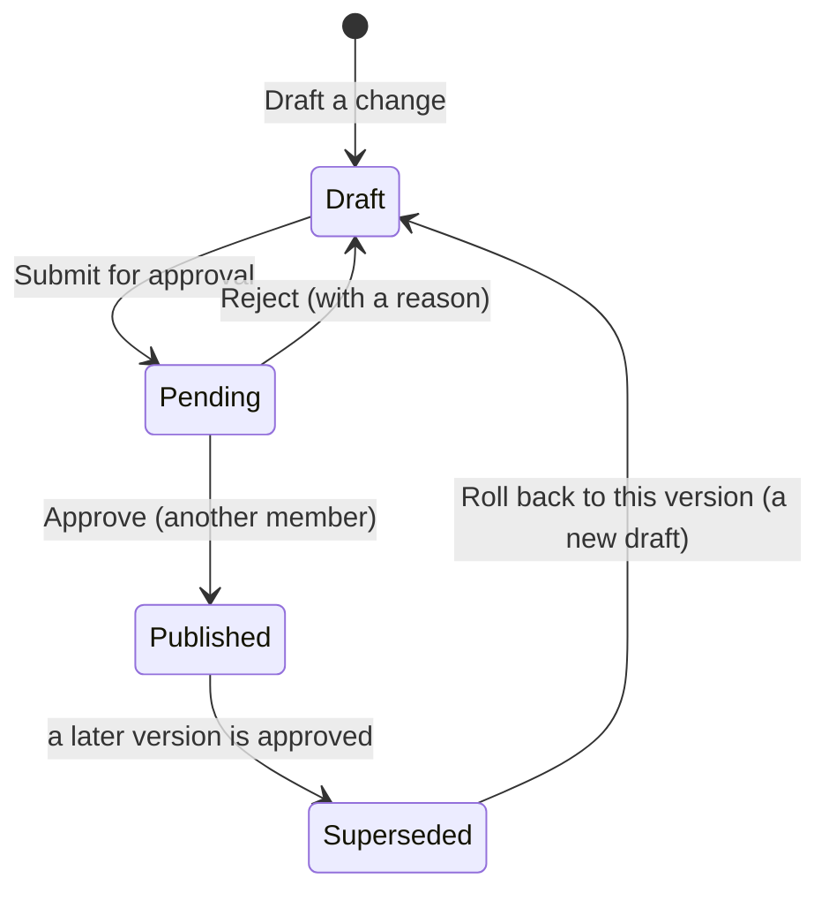

# Access policies

An **access policy** says who may pass which doors, and when. **Access
control → Access policies** lists them with their **Code**, the **Version in
force** and whether they are **Archived**; the views **In force**, **Never
approved** and **Archived** narrow the list.

The doors decide every passage in this order: emergency overrides first, then
the access point's own state (inactive or under maintenance), then the person
(unknown faces and inactive profiles are refused), then the policies in force,
then the person's access grants. Among the policies that name the person and
the door at that moment, the highest **Priority** decides; at equal priority a
**Deny** wins over an **Allow**. When nothing matches, the door refuses (**No
matching rule**, or **Outside schedule** when an allow named the person and
the door but not that moment).

## What a version says

What a policy does lives in its **versions**:

- **Effect**: allow or deny.
- **Priority**: 0 to 1000, 100 by default.
- **Schedule**: weekly hours in the time zone of the door's facility (no
  windows means always).
- **Valid from** / **Valid until**: when the version applies at all.
- **Maximum risk** (allow only): above this risk score the door refuses
  instead (**Risk too high**).
- **Who** (subjects): single people, segments (their members at the moment of
  the decision), profile types, or a minimum access level. Any one matches.
- **Where** (targets): whole facilities, areas (with the areas inside them) or
  single access points. Any one matches.

## Changing a policy: four eyes

The version in force never changes in place. Every change goes through a
draft that a **second member** approves:

1. **Draft a change** on the policy opens its open version: the draft, or the
   version waiting for approval, else a new draft copied from the version in
   force with its subjects and targets (an empty draft for a new policy).
2. Edit the draft's settings, and its **Who** and **Where** tabs.
3. **Simulate** tries the draft against the doors' past decisions before it is
   submitted (see *Policy versions*).
4. **Submit for approval** shows the whole version once more and freezes it.
   It needs at least one subject and one target.
5. Another member opens the version and chooses **Approve**, which shows what
   goes in force before it is confirmed. The member who submitted a version is
   not offered **Approve** (the button says why), and the server refuses it
   too. Approving puts the version in force at once; the previous version
   becomes **Superseded**.
6. **Reject** sends a submitted version back to draft with a reason, which the
   version keeps. The submitter can reject their own version to take it back
   for changes.

A segment named by a policy keeps its own conditions and members: those change
without a new approval and take effect at once.

## Rolling back

There is no direct republish. **Roll back to this version** on a superseded
version starts a new draft copied from it; it is submitted and approved like
any change. While the policy has an open version (a draft or one waiting for
approval), a roll back is refused: finish or discard the open version first.

## Archiving and deleting

**Archive** retires a policy for good: its version in force is superseded, a
version waiting for approval goes back to draft, and no new version can be
drafted. Terminals are updated within seconds when this narrows access
(an allowing policy is archived), otherwise within 15 minutes. A policy in
force cannot be deleted: archive it instead. A policy never approved can be
deleted; one whose versions decided at a door stays, archived, as history.

## Policy analytics

**Access control → Policy analytics** shows, for the last 30, 7 or 90 days,
how many decisions the doors made, how often each version decided, versions
in force that decided nothing (candidates for review), why doors denied, the
most denied person-door pairs, overlapping policies (versions in force naming
exactly the same people and places; conflicting when one allows and the other
denies), how the access grants of the period ended, and the size of the rule
set in force.
