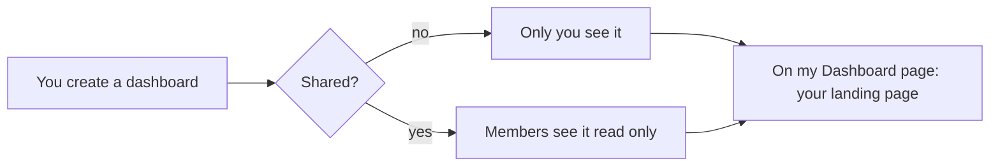

# Dashboards

A **dashboard** is your own page of analytic widgets laid out on a grid:
key figures, occupancy, moves between areas, busy hours, incidents, segment
trends, device health and notification deliveries. Each widget is one of the
blocks of the Analytics page, with its own settings.

## Who sees and changes it

- You own every dashboard you create. Only you change, share or delete it.
- **Shared** makes it visible to every member of the organization, read
  only. A member opening a dashboard shared by someone else finds Edit and
  Delete turned off, with the reason.
- Sharing never widens what anyone sees: each widget reads with the
  viewer's own permissions. A widget whose data the viewer may not read shows
  "no access" in its tile; the rest of the dashboard still draws.
- **On my Dashboard page** shows the dashboard on your Dashboard page, the
  console's landing page, above the key figures. Only one of your dashboards
  holds it at a time: choosing another takes it from the previous one.

## Widgets

Each widget has:

- a **title**, shown on its tile;
- a **kind** and what it **shows** (the query it reads). Some kinds offer two
  sources: occupancy over time or occupancy now; busy hours from the hourly
  figures or from the occupancy series; device health as a summary of every
  device, one device's charts, or every device's last 24 hours;
- its **settings**: the facility, the number of days, how many rows, and so
  on. A setting left at **Default** uses the block's own default. A
  facility widget with no facility shows the facility chosen in the sidebar;
  without one, its tile asks for it. A device health chart needs its device;
- its **place on the grid**: the column it starts at (0–11), its row
  (0–1000), its width in columns (1–12) and its height in rows of 5rem
  (1–24). A widget must fit the 12 columns: column + width is at most 12.

Tiles are drawn in reading order: by row, then by column. Empty rows above
a widget close up, and overlapping widgets stack instead of covering each
other. On a narrow screen the tiles stack in the same order. **Move earlier**
and **Move later** in the editor trade a widget's row and column with its
neighbour's.

## What is refused

The form checks the same rules the database does before saving and names
the widget that breaks them:

- at most 50 widgets, each with an id of 1 to 64 characters, unique in the
  dashboard;
- a known kind, and a source that kind may read;
- a title that is not blank, at most 200 characters;
- settings the widget's block accepts (for example busy hours over at most
  31 days);
- whole numbers for the place on the grid, within the ranges above.

A saved widget whose settings are no longer accepted (written before a
limit existed, say) still draws its dashboard: its tile names the reason, and
the editor shows the same reason on that widget until it is corrected.

The preview under the form draws the widgets on screen as the dashboard will
show them, reading live data, before anything is saved.
