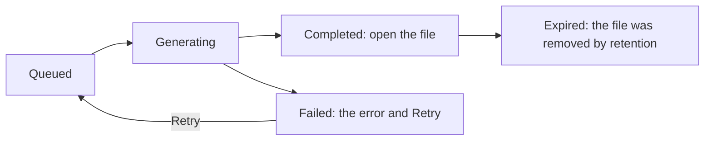

# Reports

A **report** is a file of figures — PDF, Excel, CSV or JSON — generated in
the background. It comes from one of three places:

- **New report** on the reports list, by hand;
- a **report schedule**, which runs a template regularly;
- **Generate incident report** on an incident (also listed on the
  incident's Reports tab).

## What each type is made from

| Type | Asks for | Covers |
| --- | --- | --- |
| Occupancy, Movement between areas, Busy hours, Attendance, Device health, Incident summary | a period | the chosen facilities, or every facility |
| Segment trends | a period | the chosen segments, or every segment |
| Visit frequency | a period | the organization (a snapshot of the last 30 days) |
| Compliance | a period | the organization |
| Incident report | one incident | that incident, its timeline, notes and events |

A period runs from **From** to **To**, both days included, in the chosen
time zone (empty: the organization's). The end cannot be before the start,
and it can be at most 366 days after it; the form refuses either before
anything is sent, as the database would.

What a report is about is fixed when it is requested: only its title and
description can change later. Reports are history and are never deleted.

## From request to file

- The report page shows each step as it happens and reads the report again
  every few seconds while it is queued or generating. Generation usually
  takes seconds.
- A **completed** report opens its file in a new tab through a short-lived
  link.
- A **failed** report shows why, and **Retry** queues it again with three
  new attempts. Only a failed report can be retried. `max_attempts` means
  three attempts in a row failed.
- An **expired** report keeps its record; its file was removed by the
  retention policy.

## Templates and schedules

A **report template** is a report type with its format and the period a
scheduled run covers: the previous day, week (Monday to Sunday) or month.
The built-in templates are read only; make your own to change the format or
period. A template's type is fixed once it exists.

A **report schedule** runs a template on a cron in a time zone. Each run
makes one report for the previous complete period and delivers it:

- **Email** or **In app**: to each member of the recipient group;
- **Webhook**: no recipients; the `report_generated` event goes to the
  webhook subscriptions that take it.

Incident report templates cannot be scheduled. Each report delivery is
listed on the report's Deliveries tab and, with a link to the report, in
the delivery log.
