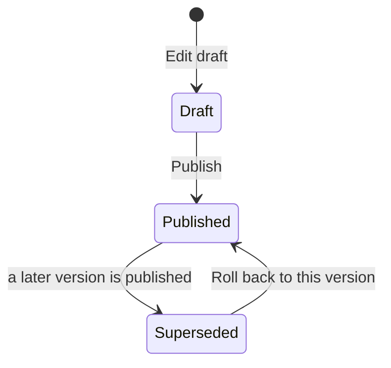

# Event rules

An **event rule** decides which events matter: how severe they are, whether
they open an **incident** for operators, and where the rule applies.
**Monitoring → Event rules** lists them with their **Rule type**, whether they
are **Enabled**, the **Version in force**, when they last triggered and how
often.

## Rule types

The type is chosen when the rule is created and never changes. It says what
the rule watches for and which parameters its versions take:

- **Unusual dwell**: someone stays in an area of the scope longer than the
  version's **Dwell time** (in minutes). Without a dwell time it never fires.
- **Watch list**: a person on a watch list is seen. **Watch-list kinds**
  limits the rule to watch lists, blacklists or VIP lists; none ticked means
  every kind (so a "Blacklist match" rule can open incidents while a "VIP
  arrival" rule only announces).
- **After hours**, **Loitering**, **Occupancy**, **Restricted area**,
  **Inactive profile**, **Tailgating**, **Unexpected facility**, **Abnormal
  movement**: no parameters of their own. They use the facility's operating
  hours, each area's loitering threshold or capacity, the access policies,
  and the organization's tailgating and movement settings.

## Versions: draft, publish, roll back

A rule's behaviour (parameters, severity, incident, scope) lives in
**versions**. The version in force never changes in place:

1. **Edit draft** on the rule opens its draft version, creating it as a copy
   of the version in force (with its scope) when there is none. A rule has at
   most one draft: asking again opens the same one.
2. Edit the draft: **Parameters**, **Severity**, **Opens an incident**, the
   **Escalation policy** its incidents get, and its **Scope** tab (add or
   remove places).
3. **Publish** on the draft puts it in force. Events from then on are
   evaluated against it; the version in force so far becomes **Superseded**.
   If someone published the draft meanwhile, the console says so and nothing
   changes.
4. **Roll back to this version** on a superseded version puts it back in
   force, for example when a new version raised too many events. An open draft
   stays as it is.

Published and superseded versions are history: they cannot be edited, their
scope cannot change, and they are never deleted (events name the version that
matched them). A draft can be discarded with **Delete**.

## Scope

A version's **Scope** tab lists where and to whom it applies: whole
facilities, areas (with their sub-areas) or segments of people. One facility,
area or segment per row. Places and segments combine: the event must happen
in one of the places and be about a member of one of the segments (at the
event time). A version with no scope applies everywhere in the organization,
to everyone. A segment's own page lists the rule versions scoped to it.

## Incidents and events of a rule

With **Opens an incident**, each match opens an incident (one per person's
stay and rule; later matches of the same stay are linked to it), with the
version's escalation policy. The rule's **Incidents** tab lists the incidents
it opened; **Events of the version in force** lists the events that version
matched. Each version's own **Events** tab lists the events it matched.

## Enabling and deleting

**Enabled** switches a rule off without losing anything. A rule that was ever
in force cannot be deleted (its history stays): disable it instead. A rule
never published can be deleted with its drafts.

Testing a draft against past events (replay) is not offered yet: the platform
has no replay function for event rules.
