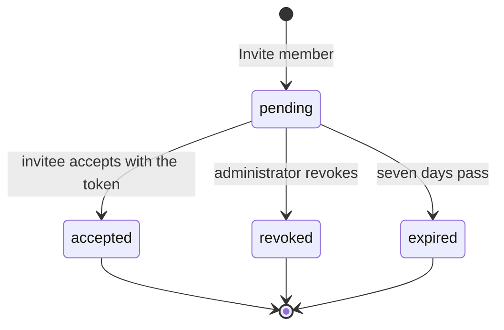

# Members and invitations

## Who can sign in

A **member** is a sign-in account that belongs to this organization. Only an
active member whose membership has not expired can open the organization in
the console; the organization switcher lists exactly those organizations. The
same account can be a member of several organizations and switches between
them without signing in again.

Members are not created by hand. A person becomes a member by accepting an
invitation, and the membership records when they joined.

## What an invitation is

An **invitation** is a one-time offer to join, addressed to an email address.
**Invite member** on the Invitations list creates one and shows its token once:
copy it and send it to the invitee, who signs up with that email address and
accepts the invitation with the token. The console never stores the token
itself, only a fingerprint of it, so a lost token cannot be shown again: revoke
the invitation and invite again.

An invitation is valid for seven days. Inviting an address that already has a
pending invitation is refused; inviting someone who is already an active member
is refused too.

## Lifecycle

Only a **pending** invitation can be accepted or revoked. Accepting it creates
the membership (or renews an expired one) with the invitation's role.
